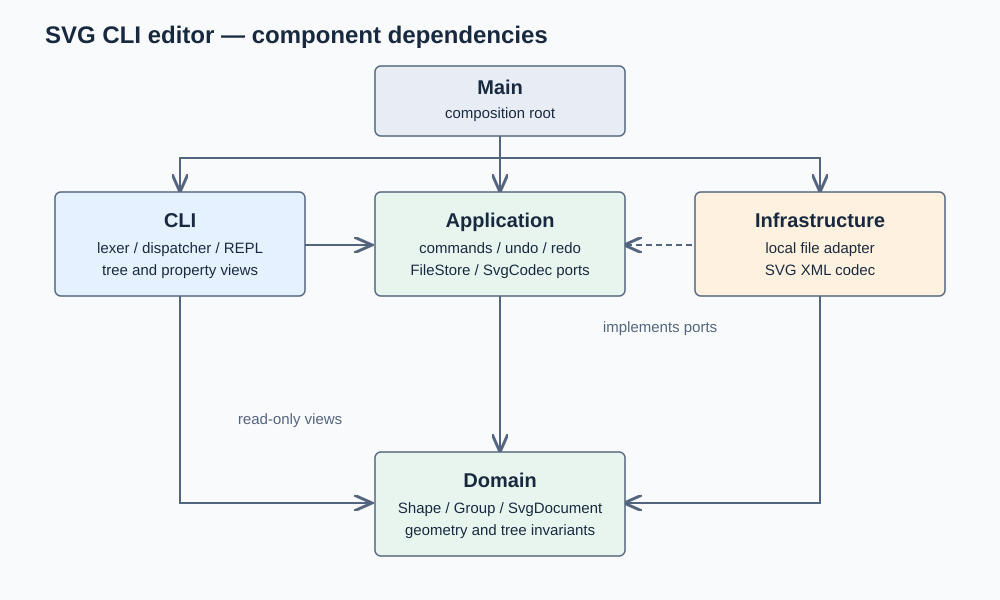
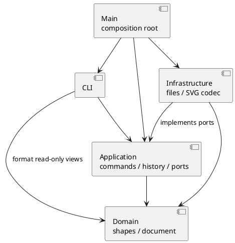

# Lab1 Phase 1：架构、过程与质量记录

当前阶段：初稿已上传 GitHub。已有实现与测试结果作为后续讨论和修改的基础；后续分天复核，最终验收及 `final` 标签仍暂缓。提交截止时间为 2026 年 10 月 31 日 23:59（北京时间）。

## 架构方案

### 模块划分

| 目录 | 职责 |
| --- | --- |
| `src/domain/` | 图形与文档；唯一 ID、父子关系、顺序、几何及属性规则 |
| `src/application/` | 用例、命令对象、撤销重做、文件与编解码端口 |
| `src/cli/` | 分词、命令分发、显示格式、逐行读取和输出 |
| `src/infrastructure/` | 本地文件适配器、SVG XML 解析与序列化 |
| `src/Main.ts` | 依赖装配与程序入口 |
| `test/` | 领域、命令会话、SVG 往返与依赖规则验收 |
| `examples/` | 可回放的命令脚本与输入 SVG |

对应 PlantUML 组件图源文件：[architecture.puml](architecture.puml)。箭头表示允许的依赖。

### 设计模式的选择

- **Command（必需）**：每条编辑对应独立命令类。历史管理器执行命令、保存前后文档快照、撤销和重做；多对象编辑仍是一个历史单元。
- **Composite**：`Shape` 是统一抽象；`Group` 持有子图形并递归移动、缩放；调用方统一按图形操作。样式设置使用 SVG 原生继承语义，不批量覆写子图形显式样式。
- **Memento**：文档通过多态 `clone()` 生成独立快照；避免用相反的浮点运算恢复坐标，并保存父子关系及原顺序。
- **Factory / Registry**：`ShapeFactory` 集中根据名称构建图形；`CommandDispatcher` 集中根据命令名分发。两处名称分派为作业允许的例外，仍记为后续插件化阶段的待重构项。本阶段不实现完整插件生命周期。
- **Ports and Adapters**：应用层通过 `FileStore`、`SvgCodec` 接口使用文件与 XML；领域层不导入 Node.js IO 或 XML 库。

### 依赖方向规则

1. Domain 仅依赖 Domain 与语言内置功能，不使用终端、文件系统或第三方 XML API。
2. Application 可依赖 Domain；通过本层接口使用 IO，不依赖 Infrastructure 或 CLI。
3. CLI 可依赖 Application 和 Domain，只负责输入解析与结果格式，不直接读写 SVG 文件。
4. Infrastructure 可依赖 Domain 与 Application 的接口，可使用 Node.js 与 XML 库。
5. Main 负责组装这些层。禁止反向引用 Main。
6. 导入 XML 标签统一交给图形工厂；显示和序列化使用图形的多态属性访问与容器结构，避免新增 `switch(tag)`。

### 变化点假设

| 可能变化 | 当前准备与边界 |
| --- | --- |
| 新图形（如 box） | 多态 Shape、集中工厂；本阶段明确拒绝 box，不实现插件系统 |
| 新编辑入口（GUI / agent） | 图形操作在应用层与领域层，命令不读终端、不打印 |
| 新存储方式 | FileStore 接口隔离本地磁盘 |
| 新导入导出格式 | SvgCodec 接口隔离 XML；不提前增加其他格式 |
| 更大的文档 | 当前以完整快照保证正确性，时间/空间与文档大小成正比；有实测性能需求后再改增量 memento |
| 更完整的 SVG 标准 | 本阶段覆盖六种内置元素与规定属性；不承诺支持任意浏览器 SVG 特性 |

## 过程记录

### 迭代 1：确认范围与建立骨架

- 根据题面确认 CLI 是交付程序的交互形式；AI 协作工具可以使用 Codex 桌面版。
- 确认 box 属于后续阶段，本次不将其作为必做功能。
- 将代码、架构文档和示例分开放置，按里程碑提交 Git；远程仓库名称、可见性与连接状态待用户提供。
- 环境未配置系统 Node.js，开发使用 Codex 附带的 Node.js；交付项目按标准 Node/npm 工程组织。

### 迭代 2：领域模型、Command 与失败回滚

- 建立六种多态图形，容器递归移动和缩放；分组按原文档遍历顺序收编，拒绝选中祖先与其后代。
- 采用完整文档 memento，让删除和分组可一次撤销，并准确恢复浮点数、原父容器与同级顺序。
- 增加溢出案例：组内第一个图形已缩放，而第二个图形发生数值溢出时，命令捕获失败并还原全部状态。
- 检查并确认失败编辑不会清除 redo，也不会解除 IO 屏障；成功编辑才清除 redo。
- 首次直接运行 tsx CLI 时，受限环境禁止其 IPC socket；改为 `node --import tsx`，测试运行器不再需要该 socket。TypeScript 编译及 7 个测试通过。
- 题面对跨父容器分组的新组位置没有明确规定：同父级时放在最早被选节点处，跨父级时追加到画布根；子节点都按原文档顺序排列。
- 成功的文档操作清除旧编辑历史并设置屏障；下一次成功编辑建立新历史，避免跨文档恢复过期快照。

### 迭代 3：SVG 读写与文件适配

- 使用 XML DOM 库解析与生成 XML；文本作为子文本节点，交由序列化器处理 `&`、尖括号与引号转义。
- 发现自动补 ID 若只查已读元素，会撞上后面出现的显式 `rect1`；改为先预留全文所有显式 ID，再为缺 ID 元素分配不冲突的编号。
- 本地保存先写同目录临时文件再重命名；读写失败使用题面要求的错误，不提前替换当前文档或历史。
- 导入支持题面六种元素、规定几何与公共样式、文本节点、数值或 px 画布尺寸。未覆盖的属性/元素显式拒绝，避免读入后悄悄丢失外观；`data-kind` 降级为普通组。
- 编译检查指出 XML 库的 `localName` 类型可能为 null；补充 tagName 回退，未通过非空断言掩盖问题。新增 5 个 SVG/文件测试，累计 12 个测试通过。

### 迭代 4：CLI 与作业会话验收

- 输入解析保留引号信息，`#ffffff` 不被当成行内注释，文本中带引号的 `in` 不被误认为归属子句。
- CLI 用 Visitor 显示各图形的几何摘要，不新增按图形名判断的分派。
- 逐条覆盖题面错误字符串；对混合编辑序列保存完整状态，逐次 undo/redo 比较每一个状态。
- 将题面主会话与两节点流程图保存为可回放脚本，分别验证预期的两条错误与无错误的流程图。
- 增加跨层导入与一类一文件检查，最终结果在质量保证节记录。

### 迭代 5：交付与复核

- 用户确定 GitHub 仓库名为 `svg-cli-editor`，可见性为公开；本地提交保留各阶段真实进展。
- 复核 `[w] [h]` 的独立可选语法：补充单宽度参数，`init w` 使用默认高度 600，`canvas w` 保留现有高度，并增加回归案例。
- 提供 macOS `run.command`，支持本机未配置系统 Node.js 时使用已有 Codex 运行时。
- 曾添加 GitHub Actions 工作流；发布时确认该功能需要额外 OAuth workflow 权限。为简化作业交付，撤下这一可选功能，保留本地构建及全部测试，不申请额外 workflow 权限。
- GitHub 插件已连接；初次网页读取多次超时，插件没有创建仓库入口。随后改用已登录的 Safari，创建公开仓库 `Ail-code/svg-cli-editor`。
- 本机旧 HTTPS 凭据返回认证失败，现有 SSH 未获 GitHub 授权；远程发布改走官方 GitHub CLI 登录流程。凭据不写入工程，不把本地提交等同于已推送。
- 登录排查发现：系统使用现有本地代理，而受限终端最初没有继承该设置。仅为登录/传输命令使用系统已有代理，没有修改系统网络配置。
- 远端随后产生只包含项目名称与描述的 README 初始提交；先 fetch，再保留双方历史完成合并。解决 README 的 add/add 冲突时保留完整运行说明，远端名称与描述信息已包含在说明中，未使用强制推送覆盖远端提交。

### 迭代节奏修订：保留初稿，分天复核

- 用户明确希望先保留初稿，隔几天再做一次小迭代，不在同一天直接定稿。
- 保留已经真实发生的开发与提交记录。后续每轮只聚焦一项需求或架构问题，结合使用反馈进行检查和必要修正，记录实际结论后提交。
- 当时暂停新增功能和登录发布流程，先帮助用户理解、试用现有实现。此后用户明确要求上传当前初稿；最终验收与 `final` 标签仍等待用户安排。

### 初稿上传：2026 年 10 月 23 日

- 完成官方 GitHub CLI 登录，确认账号为 `Ail-code`，将现有初稿及真实提交历史推送至公开仓库的 `main` 分支。
- 从 GitHub 核实源码、测试、文档和示例目录均已上传，远端提交与本地一致。保留远端最初的 README 提交，未使用强制推送。
- 当前上传的是供试用和分阶段复核的初稿，未创建 `final` 标签；后续按约定节奏进行有依据的小步修改。

## 一致性自查

### 模块划分

实际目录与方案一致。新增的 Visitor 接口、只读定位值对象放在 Domain；SVG 解析仍只在 Infrastructure；分词、显示和 REPL 在 CLI。示例 SVG 和启动脚本是交付辅助文件，不改变分层。

修订记录：最初对宽高参数按成对输入处理，复核题面后支持分别省略；初始 tsx CLI 入口改为 Node import 入口。两项都已同步到使用说明和测试。

### 依赖方向

`test/architecture.test.ts` 遍历全部源文件，检查静态 import 是否符合允许矩阵，并检查导出类的文件命名。当前检查通过。

人工抽样核对：

| 文件 | 实际依赖 | 结论 |
| --- | --- | --- |
| `domain/SvgDocument.ts` | Domain 的 Shape、Group、Numbers 等 | 符合 |
| `application/commands/MoveCommand.ts` | Application 的 EditCommand、Domain 的 SvgDocument | 符合 |
| `application/EditorApplication.ts` | Domain、Application 的 FileStore / SvgCodec 接口 | 符合，无文件系统实现依赖 |
| `infrastructure/SvgXmlCodec.ts` | XML 库、Domain、Application 工厂及接口 | 符合 |
| `cli/CommandDispatcher.ts` | Application 命令、Domain 数值校验、CLI 的解析与显示 | 符合 |

静态扫描针对现有静态 import，不宣称能识别未来引入的动态加载或运行时隐式依赖。

## 质量保证手段

### 已执行检查

开发环境为 Node.js 24.19.0、TypeScript 7.0.2。执行 `npm run check`：严格 TypeScript 构建通过，28 个自动化测试全部通过。

| 测试文件 | 数量 | 验证目标 |
| --- | ---: | --- |
| `test/domain.test.ts` | 3 | 嵌套 Composite 几何、唯一 ID、工厂边界、分组顺序 |
| `test/history.test.ts` | 4 | 浮点准确恢复、部分执行溢出回滚、子树删除恢复、IO 屏障 |
| `test/svg.test.ts` | 5 | 六种元素往返、XML 转义、补 ID 冲突、非法 SVG、真实文件读写 |
| `test/cli.test.ts` | 12 | 命令解析、所有命令类别、指定错误、状态原子性、历史与管道输入 |
| `test/acceptance.test.ts` | 2 | 作业主会话与两节点流程图回放 |
| `test/architecture.test.ts` | 2 | 依赖方向、一类一文件 |

另外使用构建后的 `node dist/Main.js` 实际回放两份脚本，生成 `examples/demo.svg`（5 个元素）与 `examples/flowchart.svg`（8 个元素）；实际运行 `run.command` 也完成流程图脚本。

### 需求与证据

| 作业要求 | 实现位置 / 验收 |
| --- | --- |
| 文档命令与历史限制 | EditorApplication、CommandHistory；CLI/历史测试 |
| 十种编辑命令与 Command | application/commands 的十个类；混合序列逐次 undo/redo |
| 六种图形与 Composite | domain/shapes；嵌套移动缩放测试 |
| in / group / addto 与层级顺序 | CreateCommand、SvgDocument；CLI/领域测试 |
| tree / show / help | CLI 的 Presenter 和 CommandDispatcher |
| 唯一 ID、缺 ID 警告、错误不改状态 | SvgDocument、SvgXmlCodec、EditCommand；对应错误及回滚测试 |
| SVG 浏览器格式、文字子节点 | SvgXmlCodec；转义与往返测试、示例输出 |
| 分步 Git 与 final | 通过 `git log --reverse --oneline` 或 GitHub 提交列表查看真实阶段记录；初稿已上传，尚未创建 final 标签 |

### 已知边界与取舍

- 当前覆盖题面内置的六种元素及规定属性。`path`、`tspan`、CSS `style`、`transform`、非匹配坐标系的 viewBox 等不在当前导入范围，显式报错；不会悄悄丢弃后继续读取。背景知识中的变换示例需先转为本阶段支持的几何坐标。
- `set` 严格使用题面白名单；不允许修改 id。颜色字符串交由 SVG 渲染器解释，未实现完整 CSS 颜色校验器。
- `box` 不实现；带 `data-kind` 的普通 g 导入后降级为 Group。
- `group` 的跨父级新组位置、单参数宽高、IO 屏障清除旧历史的具体选择已在过程记录中写明。
- Group 设置公共样式遵循 SVG 的继承；解组时将该组的显式样式补给尚未显式设置该属性的直接子节点，保留组样式带来的显示效果。
- 快照历史未限制长度，成本随图形数和编辑次数增加。本阶段优先保证准确还原，再按实际性能需求优化。
- 当前本地检查已执行；未启用远程 GitHub Actions，不将本地测试结果等同于远程测试通过。
