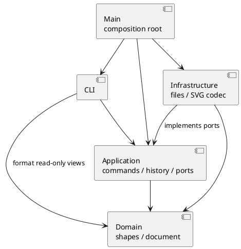

# Lab1 Phase 1：架构、过程与质量记录

## 架构方案

### 模块划分

| 目录 | 职责 |
| --- | --- |
| `src/domain/` | 图形与文档；唯一 ID、父子关系、顺序、几何及属性规则 |
| `src/application/` | 用例、命令对象、撤销重做、文件与编解码端口 |
| `src/cli/` | 分词、命令分发、显示格式、逐行读取和输出 |
| `src/infrastructure/` | 本地文件适配器、SVG XML 解析与序列化 |
| `src/Main.ts` | 依赖装配与程序入口 |
| `test/` | 领域、命令会话、SVG 往返与依赖规则验收 |
| `examples/` | 可回放的命令脚本与输入 SVG |

### 设计模式的选择

- **Command（必需）**：每条编辑对应独立命令类。历史管理器执行命令、保存前后文档快照、撤销和重做；多对象编辑仍是一个历史单元。
- **Composite**：`Shape` 是统一抽象；`Group` 持有子图形并递归移动、缩放；调用方统一按图形操作。样式设置使用 SVG 原生继承语义，不批量覆写子图形显式样式。
- **Memento**：文档通过多态 `clone()` 生成独立快照；避免用相反的浮点运算恢复坐标，并保存父子关系及原顺序。
- **Factory / Registry**：`ShapeFactory` 集中根据名称构建图形；`CommandDispatcher` 集中根据命令名分发。两处名称分派为作业允许的例外，仍记为后续插件化阶段的待重构项。本阶段不实现完整插件生命周期。
- **Ports and Adapters**：应用层通过 `FileStore`、`SvgCodec` 接口使用文件与 XML；领域层不导入 Node.js IO 或 XML 库。

### 依赖方向规则

1. Domain 仅依赖 Domain 与语言内置功能，不使用终端、文件系统或第三方 XML API。
2. Application 可依赖 Domain；通过本层接口使用 IO，不依赖 Infrastructure 或 CLI。
3. CLI 可依赖 Application 和 Domain，只负责输入解析与结果格式，不直接读写 SVG 文件。
4. Infrastructure 可依赖 Domain 与 Application 的接口，可使用 Node.js 与 XML 库。
5. Main 负责组装这些层。禁止反向引用 Main。
6. 导入 XML 标签统一交给图形工厂；显示和序列化使用图形的多态属性访问与容器结构，避免新增 `switch(tag)`。

### 变化点假设

| 可能变化 | 当前准备与边界 |
| --- | --- |
| 新图形（如 box） | 多态 Shape、集中工厂；本阶段明确拒绝 box，不实现插件系统 |
| 新编辑入口（GUI / agent） | 图形操作在应用层与领域层，命令不读终端、不打印 |
| 新存储方式 | FileStore 接口隔离本地磁盘 |
| 新导入导出格式 | SvgCodec 接口隔离 XML；不提前增加其他格式 |
| 更大的文档 | 当前以完整快照保证正确性，时间/空间与文档大小成正比；有实测性能需求后再改增量 memento |
| 更完整的 SVG 标准 | 本阶段覆盖六种内置元素与规定属性；不承诺支持任意浏览器 SVG 特性 |

## 过程记录

### 迭代 1：确认范围与建立骨架

- 根据题面确认 CLI 是交付程序的交互形式；AI 协作工具可以使用 Codex 桌面版。
- 确认 box 属于后续阶段，本次不将其作为必做功能。
- 将代码、架构文档和示例分开放置，按里程碑提交 Git；远程仓库名称、可见性与连接状态待用户提供。
- 环境未配置系统 Node.js，开发使用 Codex 附带的 Node.js；交付项目按标准 Node/npm 工程组织。

### 迭代 2：领域模型、Command 与失败回滚

- 建立六种多态图形，容器递归移动和缩放；分组按原文档遍历顺序收编，拒绝选中祖先与其后代。
- 采用完整文档 memento，让删除和分组可一次撤销，并准确恢复浮点数、原父容器与同级顺序。
- 增加溢出案例：组内第一个图形已缩放，而第二个图形发生数值溢出时，命令捕获失败并还原全部状态。
- 检查并确认失败编辑不会清除 redo，也不会解除 IO 屏障；成功编辑才清除 redo。
- 首次直接运行 tsx CLI 时，受限环境禁止其 IPC socket；改为 `node --import tsx`，测试运行器不再需要该 socket。TypeScript 编译及 7 个测试通过。
- 题面对跨父容器分组的新组位置没有明确规定：同父级时放在最早被选节点处，跨父级时追加到画布根；子节点都按原文档顺序排列。
- 成功的文档操作清除旧编辑历史并设置屏障；下一次成功编辑建立新历史，避免跨文档恢复过期快照。

### 迭代 3：SVG 读写与文件适配

- 使用 XML DOM 库解析与生成 XML；文本作为子文本节点，交由序列化器处理 `&`、尖括号与引号转义。
- 发现自动补 ID 若只查已读元素，会撞上后面出现的显式 `rect1`；改为先预留全文所有显式 ID，再为缺 ID 元素分配不冲突的编号。
- 本地保存先写同目录临时文件再重命名；读写失败使用题面要求的错误，不提前替换当前文档或历史。
- 导入支持题面六种元素、规定几何与公共样式、文本节点、数值或 px 画布尺寸。未覆盖的属性/元素显式拒绝，避免读入后悄悄丢失外观；`data-kind` 降级为普通组。
- 编译检查指出 XML 库的 `localName` 类型可能为 null；补充 tagName 回退，未通过非空断言掩盖问题。新增 5 个 SVG/文件测试，累计 12 个测试通过。

## 一致性自查

开发中。最终验收时填写实际目录、依赖检查结果及修订记录。

## 质量保证手段

计划验证：几何与容器规则；命令失败原子性；撤销重做与 IO 屏障；SVG 读写、自动补 ID、XML 转义；作业典型会话和流程图脚本；静态依赖规则。

最终测试数量、命令输出与已知边界随实现更新；不将尚未运行的检查记为通过。
